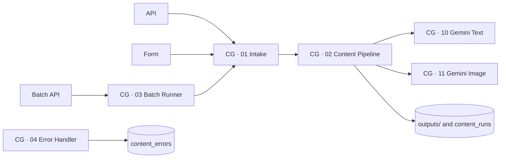

# AI Content Generation Workflow (n8n + Gemini)

Send a topic through an API, a web form or a batch request and get back a 500–800 word piece in one of five formats (article, how-to guide, opinion, trend analysis, listicle) plus a matching AI-generated image, in about a minute. Runs are steered away from recent ones so the same topic never comes back with the same format, angle or visual style. Everything runs as n8n workflows in Docker, with Google Gemini for text and images.

**Demo video:** _link to be added_

| Deliverable | Where |
|---|---|
| Workflow design, explanation, assumptions | [docs/architecture.md](docs/architecture.md) |
| Workflow export and source | [workflows/](workflows/) (n8n JSON), [config/content-config.json](config/content-config.json), [scripts/](scripts/) |
| Setup and execution instructions | [docs/setup.md](docs/setup.md), API reference in [docs/api.md](docs/api.md) |
| Sample outputs | [samples/](samples/README.md): 7 pieces on 6 topics, one per format plus a same-topic diversity pair |
| Demo video | link above |

## What it does

- **Three ways in**: authenticated JSON API (`POST /webhook/content`), an n8n web form that renders the result, and a batch API that returns `202` immediately and processes up to 50 topics with bounded concurrency.
- **Five formats**, each with its own structure, tone, rules, quality checks and preferred visual styles, all defined in one config file.
- **Diversity across runs**: a planner reads the last 50 runs and chooses format, angle, opening hook, audience, visual style, composition, palette and lighting, excluding what the previous run and the latest same-topic run used. A novelty gate regenerates the brief if its title is too close to a recent one.
- **Quality gate**: word count, structure, paragraph length, banned clichés, no links, and format-specific checks; failures turn into targeted revision instructions (up to two revisions).
- **Within 5 minutes**: one 280 s deadline is propagated to every model call. Measured: p50 45 s, p95 64 s; $0.07–0.10 per piece.
- **Resilient**: every model call retries once and falls back to a second model; image failure still delivers the article; unexpected errors are logged by an error workflow; faults can be injected on demand to demonstrate all of it.

## How it works



The pipeline runs five stages, each a group on the n8n canvas: **validate & plan → brief → write & quality gate → illustrate → finalize & persist**. Model calls go through two gateway sub-workflows that own retries, fallback, timeouts, JSON parsing and cost tracking.

| Workflow | Purpose |
|---|---|
| CG · 00 Setup | Creates the Data Tables (idempotent) |
| CG · 01 Intake | API + form front doors, HTTP status mapping, HTML result page |
| CG · 02 Content Pipeline | Validation, diversity planning, brief, writing, quality gate, image, files, run log |
| CG · 03 Batch Runner | Bulk generation in waves, batch summary with latency percentiles and cost |
| CG · 04 Error Handler | Logs failed executions to `content_errors` |
| CG · 10 Gemini Text | Text gateway: primary/fallback model, retry, deadline-aware timeout, JSON schema output |
| CG · 11 Gemini Image | Image gateway: same pattern, 16:9 / 1:1 / 4:5 at 1K |

## Quick start

```bash
scripts/init-env.sh                 # creates .env with generated secrets; then add GEMINI_API_KEY
docker compose up -d                # n8n 2.47.7 on http://localhost:5678
# open http://localhost:5678 and create the owner account
scripts/setup.sh                    # credentials, workflows, publish, Data Tables
scripts/generate.sh "How to launch a digital retailing program at a car dealership" guide
```

Or open http://localhost:5678/form/content-form. Full instructions and troubleshooting: [docs/setup.md](docs/setup.md).

## Key design decisions

- **Gemini through HTTP Request nodes behind gateway sub-workflows.** The built-in nodes cannot set image aspect ratio and size, JSON schema output or request timeouts, and hide their own retries. The gateways keep that control in one place, with the API key still in n8n's encrypted credential store.
- **Deterministic logic in Code nodes, generation in the model.** Validation, diversity planning, quality checks and status decisions are plain code with explainable outputs; the model only plans, writes and draws.
- **Config over code.** Models, prices, timeouts, formats, pools, limits and quality rules live in `config/content-config.json`, read on every run.
- **The run log is also the diversity memory.** `content_runs` records every choice, so the planner, the novelty gate and an auditor all read the same data. Plans are reserved before generation so concurrent runs also diverge.
- **Graceful degradation over failure.** A missing image yields `partial`, failing checks yield `needs_review` with the reasons; only a missing article is a failure.
- **Synchronous API, asynchronous batch.** One run finishes well inside 5 minutes, so the API answers directly; bulk work is accepted with `202` and polled.

Assumptions, limitations and the path to large-scale operation (queue mode, Postgres, rate limiting, Gemini Batch API, object storage) are in [docs/architecture.md](docs/architecture.md#13-scaling-to-large-volumes).

## Repository layout

```
config/content-config.json   models, prices, budget, formats, diversity pools, quality rules
workflows/                   exported n8n workflows (import with scripts/setup.sh)
scripts/                     init-env, setup, generate, run-batch, collect-samples, export, check-gemini
samples/                     generated sample outputs with a gallery README
docs/                        architecture, setup, API reference
outputs/                     generated files (git-ignored)
docker-compose.yml           pinned n8n service
```
