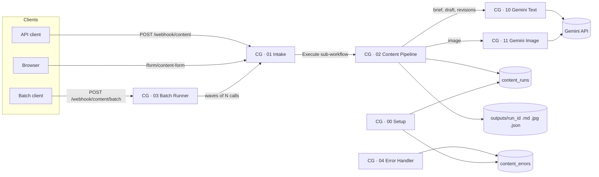
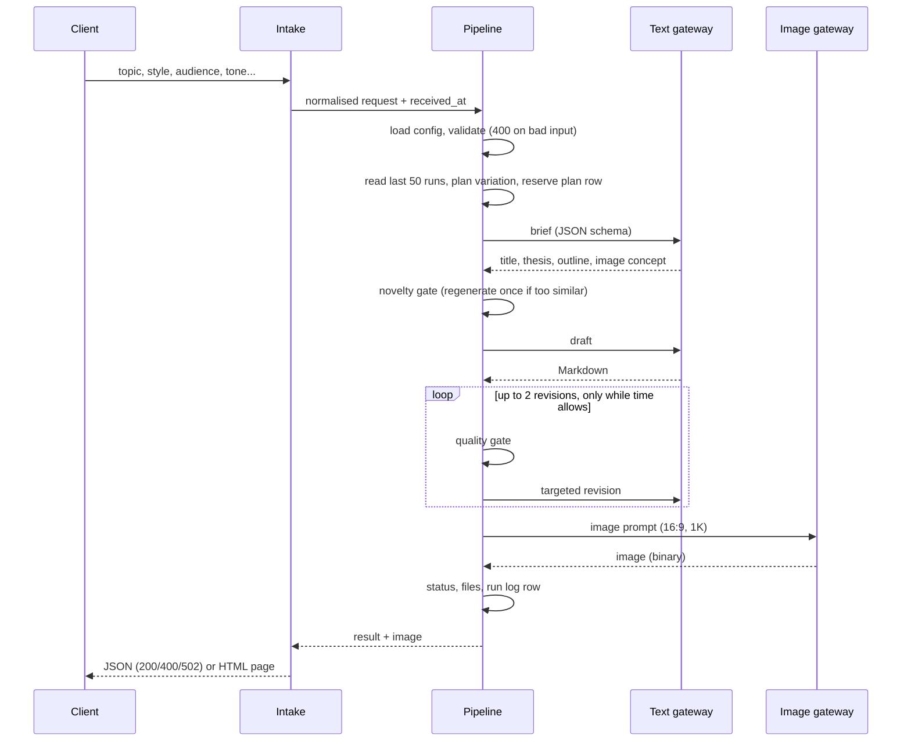

# Architecture and design decisions

## 1. Requirements and how they are met

| Requirement | How the workflows meet it |
|---|---|
| Topic in through webhook, form or API | **CG · 01 Intake** exposes an authenticated JSON API and an n8n form. **CG · 03 Batch Runner** accepts many topics at once. |
| 500–800 words plus a relevant image | Brief → draft → quality gate (word count enforced, targeted revisions) → image built from the brief's own image concept. |
| Several styles and formats | Five formats in `config/content-config.json`: article, how-to guide, opinion, trend analysis, listicle. Each has its own structure, tone, rules, style-specific checks and preferred visual styles. |
| Content and visual diversity across runs | A planner reads recent runs and draws format, angle, hook, audience and four visual dimensions with exclusions and weights, then a novelty gate rejects titles that repeat recent ones (section 5). |
| End to end within 5 minutes | One 280 s deadline is propagated to every model call; revisions stop at 200 s; workflow timeouts of 300 s (intake) and 290 s (pipeline) are the hard stop. Measured p95 is 64 s (section 12). |
| Basic error handling and retries | Each model call retries once, then falls back to a second model; failures degrade gracefully; unexpected crashes go to an error workflow and a log table; faults can be injected on demand (section 9). |
| Modular, maintainable, scalable | Seven single-purpose workflows, two reusable model gateways, all tunables in one config file, a batch runner with bounded concurrency, and a scaling path (section 13). |

## 2. Workflow map

| Workflow | Role | Trigger |
|---|---|---|
| CG · 00 Setup | Creates the two Data Tables (idempotent) | Manual, or `POST /webhook/content/setup` from `scripts/setup.sh` |
| CG · 01 Intake | API and form front doors; maps results to HTTP codes or an HTML page | Webhook + n8n Form |
| CG · 02 Content Pipeline | Everything between a validated topic and saved files | Called as a sub-workflow |
| CG · 03 Batch Runner | Bulk generation with bounded concurrency, batch status endpoint | Two webhooks |
| CG · 04 Error Handler | Logs failed production executions | Error Trigger (set as the error workflow of all others) |
| CG · 10 Gemini Text | Text model gateway: request building, retry, fallback, JSON parsing, usage and cost | Called as a sub-workflow |
| CG · 11 Gemini Image | Image model gateway: same pattern, returns the image as binary | Called as a sub-workflow |

Every workflow uses canvas groups (one per stage) and sticky notes, so each one reads left to right as a short story.

## 3. One run, step by step

## 4. Content pipeline stages

1. **Validate & plan.** Reads `config/content-config.json` from disk on every run (change models, styles or limits without touching workflows). Validates topic length, style, audience, tone, word target and image aspect, returning every error at once (`status: rejected`, HTTP 400). Assigns a `run_id`, a 280 s deadline, then plans the variation (section 5) and writes a `planned` row to `content_runs`.
2. **Brief.** One schema-constrained call returns title, meta description, thesis, 3–8 sections with key points, keywords and an image concept. The prompt carries the format's structure and rules, the planned audience, tone, angle and opening hook, and the titles of recent related pieces to avoid. An incomplete brief, or a title too close to a recent one, is regenerated once.
3. **Write & quality gate.** The writer gets the brief as an outline plus hard rules (no invented statistics, quotes, sources or links; banned clichés; paragraph length). The gate scores the draft deterministically (section 6); failures become a list of concrete fix instructions for a targeted revision, at most twice and only before the 200 s mark. If a revision call fails, the previous draft is kept.
4. **Illustrate.** The image prompt combines the brief's subject, setting, details and mood with the planned visual style, composition, palette and lighting, plus hard rules: no text, logos, watermarks, brand marks or recognisable people.
5. **Finalize & persist.** Sets the status, writes `outputs/<run_id>.md` (front matter + Markdown + image link), the image and `outputs/<run_id>.json` (full metadata), updates the run row and returns the result. Failed runs still write their metadata file and log row.

| Status | Meaning | API code |
|---|---|---|
| `success` | Article passed every check and has an image | 200 |
| `partial` | Article passed, image unavailable | 200 |
| `needs_review` | Article still fails a check after the allowed revisions (warnings say which) | 200 |
| `failed` | No usable article (both text models failed) | 502 |
| `rejected` | Invalid input | 400 |
| `error` | Unexpected workflow failure or timeout (logged by the error handler) | 500 / 504 |

## 5. Diversity logic

Diversity is designed in, measured, and remembered:

- **Planned variation.** Each run draws seven dimensions from pools in the config: format (when `style` is `auto`), angle (10 options such as myth-busting, ROI lens, customer journey), opening hook (6), audience (6, unless the caller sets one) and, for the image, visual style (10), composition (6), palette (8) and lighting (5). That is over 4 million combinations before the prompts themselves vary.
- **History-aware weights.** The planner reads the last 50 runs from `content_runs`. Topics are compared with a token Jaccard similarity (stop words removed, light stemming); runs at 0.5 or above count as related. For every dimension:
  - the choice made by the previous run, and by the latest run on a related topic, is excluded,
  - choices used by older related runs are down-weighted to 0.2,
  - visual styles that suit the format (for example isometric illustration for guides) get a 2x boost.
- **Concurrency.** Each run writes its plan as a `planned` row before generating, and the batch runner staggers the requests in a wave by 2 s, so runs that execute at the same time still steer away from each other. Reservations older than 10 minutes are ignored.
- **Novelty gate.** The brief prompt lists the titles of the 5 most recent related pieces to avoid. After the brief, the new title is compared with them; above 0.6 similarity the brief is regenerated once with explicit "be different" instructions. The score is stored per run.
- **Reproducible.** The draws use a PRNG seeded from the `run_id`; the seed and every choice are saved in the metadata and the run row, so any plan can be explained after the fact.

The two last samples in [samples/](../samples/README.md) use the same topic with `style: auto`; the second run changed format, angle, hook, audience and every visual dimension.

## 6. Quality gate

Deterministic, explainable checks run on every draft (no extra model call):

| Check | Rule |
|---|---|
| `word_count` | 500–800 words of body text (target 650 by default, configurable 550–750 per request) |
| `sections` | At least 3 `##` sections |
| `paragraph_length` | No paragraph over 120 words |
| `banned_phrases` | None of the configured clichés and placeholders ("delve", "in today's fast-paced world", "lorem ipsum", "[insert"...) |
| `no_links` | No URLs or Markdown links (the model cannot verify sources) |
| `steps` (guide) | At least 5 "Step N" sections |
| `numbered_items` (listicle) | At least 5 numbered `##` items |
| `required_section` (opinion, trend analysis) | A counterargument section, or a "what to watch" outlook section |

Each failed check produces a specific instruction ("It has 912 words; tighten it to about 650 without dropping any section."). The metadata keeps the checks for every draft (`quality.rounds`), so you can see what each revision fixed.

## 7. Model gateways

All model traffic goes through two small sub-workflows, so the pipeline never deals with HTTP details:

- **Primary, then fallback.** Text: `gemini-4-hydrogen`, then `gemini-3.8-flash`. Image: `gemini-nano-banana-2.1`, then `gemini-3.1-flash-lite-image`. Model IDs live in the config.
- **Retry.** Each call retries once after 2 s (n8n *Retry On Fail*), which absorbs transient 429 and 5xx responses.
- **Error routing.** HTTP failures leave through the node's error output; empty, blocked, truncated or invalid-JSON answers are caught by the parse step. Both paths lead to the fallback.
- **Deadline-aware timeouts.** Each call's timeout is `min(configured timeout, time left before the run deadline − 2 s)`.
- **One result shape.** `{ ok, text | data | binary image, model, fallback_used, usage, cost_usd, latency_ms, attempts[], error, passthrough }`. The gateways never throw on model failure; the caller decides. `passthrough` carries the run context through the call.
- **Usage and cost.** Token counts (including thinking and image tokens) are priced from the config table per attempt, so failed attempts that still cost money are counted.

Why HTTP Request nodes instead of the built-in Gemini nodes: the built-in image operation has no aspect ratio or size option, the text node has no JSON schema, and the LangChain chat model exposes neither timeouts nor its internal retries (6 by default). The HTTP node with n8n's predefined Gemini credential gives full control of `responseJsonSchema`, `thinkingConfig`, `imageConfig` and timeouts while the key stays in n8n's encrypted credential store.

## 8. Time budget

| Guard | Value |
|---|---|
| Run deadline, propagated to every call | 280 s from request receipt |
| Last moment a revision may start | 200 s |
| Per-call timeouts | brief 45 s, draft/revision 75 s, image 90 s (each capped by the deadline) |
| Workflow timeouts | Intake 300 s, pipeline 290 s, gateways 280 s, batch runner 1 h |

Worst case is bounded by the deadline, not by the sum of timeouts. Typical runs take 37–73 s.

## 9. Error handling

| Failure | Behaviour | Client sees |
|---|---|---|
| Invalid input | All errors collected, no model calls | 400 `rejected` with `errors[]` |
| Wrong or missing API key | Rejected by the webhook | 403 |
| Transient model error (429/5xx) | Retried once after 2 s | Nothing |
| Primary model down, blocked or malformed output | Fallback model | `fallback_used: true` |
| Both text models fail | Run logged as failed, metadata written | 502 `failed` with the reason |
| Both image models fail | Article delivered without image | 200 `partial`, warning |
| Quality checks still failing | Article delivered, flagged | 200 `needs_review`, warnings |
| Revision call fails | Previous draft kept | Warning |
| Unexpected crash or timeout | Error workflow writes `content_errors` (workflow, node, message, execution link) | 500 / 504 with execution id |

**Fault injection** (enabled by `flags.allow_fault_injection`): send `"simulate": {"text_primary_fail": true}`, `{"image_primary_fail": true}` or `{"fatal": true}`. The primary-failure flags point the call at a non-existent model, so the real API returns a real 404 and the real retry and fallback path runs.

## 10. Data and storage

- **Files**: `outputs/<run_id>.md`, `.jpg` and `.json` on a bind mount. Flat names because n8n's file node cannot create folders; run ids start with a timestamp, so they sort chronologically.
- **`content_runs`** (n8n Data Table): one row per run with inputs, every diversity choice, title, word count, revisions, novelty, models, fallback flag, duration, cost, status and error. It is both the audit log and the planner's memory.
- **`content_errors`**: one row per failed production execution.
- **Config**: `config/content-config.json`, mounted read-only.
- **Secrets**: the Gemini key and the API key live only in n8n credentials (encrypted with `N8N_ENCRYPTION_KEY`) and in the local `.env`.

## 11. Security

- The API and batch endpoints require `X-API-Key` (n8n header auth credential).
- The Gemini key is never passed into the container environment, never appears in workflow JSON, and scripts send keys through file descriptors, not command-line arguments. `scripts/export.sh` fails if any `.env` secret appears in the exported workflows.
- File access is restricted to `/home/node/.n8n-files`. The batch status endpoint accepts only ids matching a strict pattern before building a file path.
- Model output is rendered on the form page through an escaping Markdown renderer; links are rejected by the quality gate.

## 12. Measured latency and cost

From the sample batch (7 topics, concurrency 3) and single API runs on the same day:

| Metric | Value |
|---|---|
| Single run, typical | 37–55 s (brief ~10–18 s, draft ~11–17 s, image ~6–31 s) |
| Batch of 7, concurrency 3 | 158 s wall time; p50 45 s, p95 64 s per run; 7/7 within 5 minutes |
| Cost per run | $0.07–0.10 (about $0.045 of it is the image); $0.04 on the fallback models |

## 13. Scaling to large volumes

What is in place:

- **Batch API** with a 202 response, bounded concurrency (1–5), staggered dispatch, and a status endpoint with p50/p95 latency and cost per batch.
- **Stateless workflows**: all state is in the run context, the Data Tables and files, so executions can run on any worker.
- **Gateways as the single place** to add rate limiting, caching, model routing or a new provider.

What to change for thousands of pieces a day:

1. Run n8n in **queue mode** (Redis + several workers) on **Postgres** instead of SQLite; set `N8N_CONCURRENCY_PRODUCTION_LIMIT`.
2. Add a **per-model rate limiter** in the gateways (token bucket in Redis) sized to the Gemini quota, and route overflow to the fallback model.
3. Use the **Gemini Batch API** for non-urgent text (about half the price, asynchronous).
4. Store assets in **object storage** (S3/GCS) and keep only URLs in executions; enable execution-data pruning and save only failed executions in the gateways.
5. Move run history to a real database with an index on `topic_key`, and do planning inside a transaction (or a per-topic lock) so the diversity reservation is race-free.
6. Add **idempotency keys** on the API so client retries do not create duplicates.

## 14. Assumptions

- Content is in English, for a general professional audience unless the caller sets one. Samples use automotive retail topics; nothing in the pipeline is domain-specific apart from the "unbranded vehicles" image rule.
- The 500–800 word count covers the article body (headings included, title and front matter excluded).
- One request produces one article and one image (16:9, 1K by default; 1:1 and 4:5 are allowed).
- The API is synchronous because a run finishes well within the 5-minute budget; bulk work goes through the asynchronous batch API.
- Output is stored locally on the host; publishing to a CMS is out of scope.
- No web search grounding: the writer is instructed not to invent figures, quotes or sources, and links are rejected. Factual accuracy beyond that is not verified.

## 15. Known limitations and next steps

- The quality gate checks structure and style rules, not facts. A model-graded review (factuality, readability) could run as a separate step for `needs_review` items.
- Trend analysis would benefit from optional Google Search grounding (off by default because of cost and latency).
- Diversity is statistical within the configured pools; growing the pools, or generating angles per topic, widens the space.
- Images are base64 in execution data while a run is in flight (about 1–2 MB per execution). Fine locally; object storage fixes it at scale.
- The batch runner keeps a whole batch inside one execution (max 50 topics); larger jobs should go through a queue.
