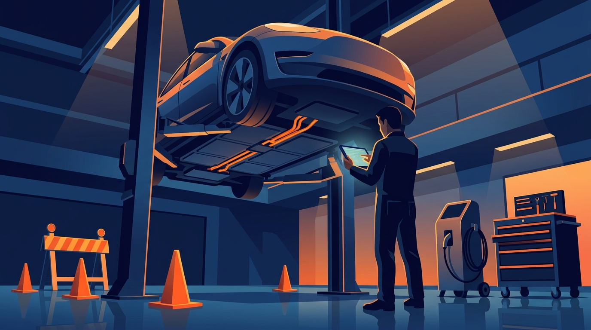

# How Electric Vehicles Will Reshape Dealership Service Revenue

## Where Dealership Service Revenue Stands Today

Elena, a veteran service director at a multi-franchise dealership, recently noticed a quiet shift on her morning bay schedule. Where routine oil changes and transmission flushes once filled every lift, technicians are increasingly plugging laptops into electric vehicles for software diagnostics.

Fixed operations—encompassing service and parts—remain a primary profit center for most dealerships, historically insulated by the predictable, recurring maintenance needs of internal combustion engines. Today, however, electric vehicle adoption is uneven across regions. Coastal and urban dealerships are already seeing a noticeable share of electric models in their service lanes, while rural and suburban shops still rely heavily on legacy gasoline vehicles. As a result, most service departments are currently managing a hybrid workload, balancing traditional mechanical repairs alongside early electric vehicle diagnostics.

## The Three Main Drivers Behind the Shift

Three structural forces are reshaping how dealerships generate service revenue, though their full impact will unfold gradually:

- **Fewer moving parts:** Electric powertrains eliminate oil changes, spark plugs, timing belts, and exhaust repairs. This directly reduces the high-frequency, predictable visits that have long anchored dealership service bays.
- **Higher-value, specialized repairs:** While routine visits may decline, electric vehicles introduce complex systems. Battery diagnostics, thermal management, and high-voltage component replacements require specialized tooling and carry higher ticket potential when issues arise.
- **Software-defined vehicles:** Over-the-air updates already allow automakers to patch software glitches remotely. Over time, this capability could resolve a growing share of minor faults without a vehicle ever entering a service bay.

## Implications for Different Stakeholders

For dealership owners, the central challenge is timing capital allocation. Investing early in high-voltage tooling, reinforced lifts, and charging infrastructure can position a store as a regional leader, but premature spending risks tying up capital before local electric vehicle volume justifies the outlay. Waiting too long, however, could mean ceding early adopters to competitors.

Service technicians face an equally steep transition. Shifting from mechanical repair to electrical and software diagnostics requires sustained training. Shops that delay upskilling risk creating a labor bottleneck and losing experienced technicians to competing franchises or independent specialists.

Meanwhile, competition is intensifying. Automakers are increasingly positioned to manage software-driven maintenance directly, while independent repair shops are aggressively targeting tire, brake, and suspension work—areas where heavier electric vehicle batteries continue to drive steady wear.

## What to Watch Over the Next 12 to 24 Months

Decision-makers weighing where and when to invest should monitor several leading indicators over the next 12 to 24 months:

- **Warranty reimbursement:** Watch how manufacturers structure labor rates and diagnostic allowances for complex battery and software repairs, as these terms will heavily influence service department margins.
- **Regional adoption curves:** Track whether electric vehicle sales accelerate in non-urban markets, which will signal when regional dealerships may hit a tipping point in bay utilization.
- **Pricing and packaging:** Observe how dealerships structure subscription-based maintenance plans and price tire, brake, and alignment services to offset declining engine work.

## The Bottom Line

Electric vehicles will not eliminate dealership service revenue overnight, but they will steadily compress the high-margin, routine maintenance that has historically sustained fixed operations. Rather than making sweeping bets, decision-makers should pace infrastructure and tooling investments to match their local fleet mix. Prioritizing technician certification and retention today will provide the flexibility needed to adapt as the market evolves.
