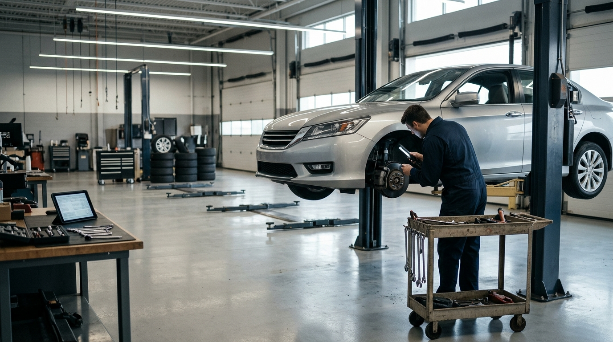

# 5 Ways to Cut Used-Car Reconditioning Time and Boost ROI

A used car sitting in recon is like a race car stuck in the pit lane with the engine running—every second burns fuel and costs you the race. Treating reconditioning like a high-speed pit crew rather than a waiting room slashes daily holding costs and turns your inventory faster. Here are five practical ways dealerships can cut reconditioning time, protect gross margin, and get vehicles front-line ready faster.

## 1. Triage Vehicles at Appraisal
**Spot deal-breakers before the car even hits the service bay.**
Waiting until a vehicle reaches the shop to discover major mechanical or cosmetic issues stalls the entire pipeline and bleeds floorplan capital. Train your appraisers to flag high-cost repairs, safety concerns, and sublet needs on the spot so parts can be ordered immediately and wholesale candidates are routed out fast. When the service team knows exactly what is coming before the keys hit the board, you eliminate surprise delays, avoid wasted technician hours, and keep your bays moving at full speed.

## 2. Set Hard Time Limits per Stage
**Cap every recon phase with a strict clock to eliminate silent bottlenecks.**
Without stage-specific deadlines, cars linger in detail, body work, or photography while managers assume someone else is handling it. Assign clear time budgets—such as 24 hours for mechanical inspection and 48 hours for parts—to protect your daily holding cost and keep every department accountable. When every team member knows the exact clock they are working against, vehicles stop slipping through the cracks and your inventory turn rate climbs.

## 3. Pre-Order Common Wear Parts
**Stock high-turn parts in-house so technicians never wait on a delivery truck.**
A service bay sitting idle for a set of brake pads, cabin filters, or wiper blades destroys shop efficiency and delays your online retail listing. Analyze your top-selling models and keep fast-moving wear items on the shelf to turn multi-day waits into same-day fixes that get cars photographed and priced immediately. Your technicians get paid to turn wrenches, not to wait by the parts counter while your holding costs tick upward.

## 4. Batch Sublet Work Strategically
**Group paint, dent, and wheel repairs on fixed vendor days to cut transit time.**
Sending cars off-site one by one creates scheduling chaos, racks up transport expenses, and adds days of dead time to your recon cycle. Lock in dedicated weekly or bi-weekly vendor visits right on your lot so multiple vehicles get repaired in a single, coordinated sweep. Keeping sublet work batched and on-site turns a logistical headache into a predictable, high-ROI routine that gets retail-ready cars onto the front line faster.

## 5. Automate Status Alerts for Managers
**Replace manual walk-arounds with automated alerts when a car stalls.**
Chasing down technicians, calling vendors, or checking paper clipboards wastes hours that could be spent appraising trades or closing deals. Use simple digital tracking to ping the used-car manager the moment a vehicle exceeds its stage budget, keeping ROI and speed-to-market front and center. Real-time visibility lets you step in, reassign resources, and clear a roadblock before it costs you another day of holding expense.

Every day shaved off reconditioning directly protects your gross margin and frees up floorplan capital for fresh, high-demand inventory. Pick one bottleneck from this list, set a timer this week, and watch your front-line readiness accelerate.
