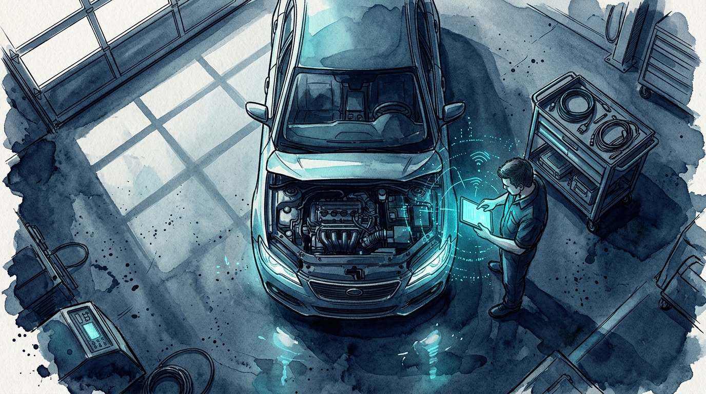

# From Guesswork to Telemetry: How Connected-Car Data Keeps Dealership Customers Returning

## The Shift From Blind Spots to Real-Time Signals

For decades, dealership service retention relied on waiting. Advisors waited for a customer’s odometer to cross a mileage milestone, or for a dashboard warning light to trigger a panicked phone call. Today, connected-car data replaces that guesswork with continuous, real-time vehicle health monitoring. Instead of reacting to breakdowns, dealerships can spot emerging maintenance needs before a driver notices a symptom.

This shift matters now because tightening margins on new vehicle sales have made fixed operations—the service, parts, and repair departments—the primary driver of dealership profitability. Keeping existing customers returning to the service bay is no longer just a retention goal; it is essential to the business.

## How We Got Here: From Paper Stickers to Telematics

To understand the opportunity, it helps to look at how service reminders evolved. First came the paper oil-change sticker on the windshield, which left dealerships hoping the driver would remember to look at it. Next came early Customer Relationship Management (CRM) software, which estimated service intervals using average annual mileage. Because those estimates were based on broad assumptions, dealerships often sent reminders at the wrong time.

Modern connected vehicles changed that equation through telematics—the technology that transmits vehicle diagnostics and usage data over cellular networks. Every connected car now acts as a live data source, reporting actual mileage, fluid levels, battery health, and fault codes directly to the systems dealerships use to manage service.

## What History Teaches Us About Customer Trust

Past retention tools often failed because they prioritized volume over relevance. Sending generic mass emails for an oil change a customer already completed elsewhere did not just waste marketing dollars; it signaled that the dealership did not actually know the customer's vehicle. Over time, those irrelevant messages eroded trust and trained drivers to ignore dealership outreach.

Telematics solves this by making communication specific and timely. For example, if a vehicle’s battery-voltage telemetry shows a steady drop ahead of a winter cold snap, the dealership can send a targeted alert recommending a battery check before the car fails to start. That kind of helpful, accurate outreach builds credibility in a way a generic discount coupon never could.

## Turning Data Into Service-Bay Revenue

Data alone does not generate revenue; action does. Leading dealerships connect vehicle telemetry alerts directly to their scheduling and inventory software so that insights turn into booked appointments. When the system flags a developing issue, the service team can reach out with a clear explanation and an open time slot.

Consider worn brake pads. When a vehicle’s sensors report that pad thickness has dropped below a set threshold, the dealership’s system can automatically notify the parts department to order the exact components needed for that specific model. By the time the customer books the appointment, the parts are already on the shelf, reducing bay wait times and improving technician efficiency.

## What Decision-Makers Should Weigh Before Investing

Before committing to a connected-car platform, dealership leaders should evaluate both technology agreements and team readiness:

* **Data-sharing agreements:** Review contracts with automakers and third-party vendors carefully to ensure the dealership retains control of the customer relationship and direct communication channels.
* **Staff workflows:** Service advisors need clear, simple processes to act on telemetry alerts. If a system floods advisors with raw diagnostic codes, it will overwhelm the team rather than help them serve the customer.

## The Road Ahead

Technology has moved dealerships from paper stickers to live vehicle diagnostics, but the core lesson remains the same: relevance earns loyalty. Connected-car data does not replace the human relationship at the dealership; it simply ensures you are there with the right answer before the customer knows they have a question.
