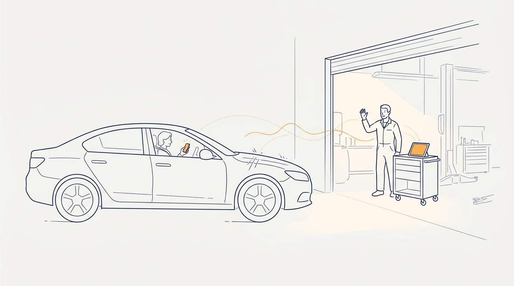

# 5 Ways Connected-Car Data Actually Wins Back Skeptical Drivers

Why would a driver who hates dealership upsells ever trust you with their car's live data? Most skeptics assume connected-car tech is just another excuse to spam their inbox with overpriced maintenance packages. Here are five practical ways connected-car data turns those skeptical buyers into repeat service customers. We'll follow the customer's journey step by step, from the first drive-off to trade-in.

## 1. Catching early-stage issues before the check-engine light ruins their week

**Takeaway: Proactive alerts beat reactive panic.**

During the first few thousand miles after driving off the lot, drivers expect perfection—and they resent any surprise that disrupts their routine. Instead of waiting for a breakdown on a busy morning, your service team can spot a subtle battery dip or sensor fault early. Sending a simple, no-pressure heads-up via text shows you're looking out for them, not hunting for a quick buck. When you solve a problem before they even notice a symptom, skepticism melts into genuine relief.

## 2. Ditching generic mileage reminders for actual driving habits

**Takeaway: Real-world wear beats arbitrary calendar dates.**

Around month six, routine maintenance rolls around, and nothing annoys a driver faster than a robotic reminder for a service they don't need yet. Heavy city traffic, extreme temperatures, and short trips age engine oil and brake pads much faster than easy highway cruising. By using actual driving data, your service invites reflect how they really use their vehicle. Tailored outreach feels helpful rather than pushy, proving you respect both their schedule and their wallet.

## 3. Making warranty and recall fixes painless instead of a surprise

**Takeaway: Pre-ordered parts turn a hassle into a quick pit stop.**

Mid-ownership is when recalls or technical service bulletins tend to pop up, usually at the worst possible time. Normally, a driver has to drop off their car, wait for a technician to diagnose the issue, and then wait days for the right component to arrive. Connected diagnostics let your service bay identify the exact fix and order the part before the customer even calls. Turning a multi-day ordeal into a fast, predictable visit is the easiest way to win over a doubter.

## 4. Offering trade-in numbers based on real condition, not guesswork

**Takeaway: Verified maintenance history earns a fairer, faster offer.**

By year three or four, the itch for a new car starts—along with the dread of haggling over a trade-in. Skeptics hate lowball appraisals that ignore how well they've cared for their vehicle. Sharing a data-backed health report proves their car's true condition and removes the guesswork from the valuation. When you back up your offer with hard facts from their ownership history, you build instant trust and eliminate the usual showroom friction.

## 5. Timing the next-car conversation when their current ride hits peak equity

**Takeaway: Relevant timing beats random sales blasts.**

As the driver approaches the transition to their next vehicle, they tune out generic "we want your car" postcards. Combining real-time mileage, warranty expiration dates, and local market demand lets you reach out only when upgrading actually makes financial sense. Instead of a cold sales pitch, you're delivering a timely opportunity that protects their equity. Even the most guarded customer will listen when the math clearly works in their favor.

Connected-car data isn't magic, and it won't fix bad service. But when dealerships use it to solve real driver headaches at each stage of ownership, the skepticism fades. Use it to respect the driver's time at every step, and they'll keep coming back.
