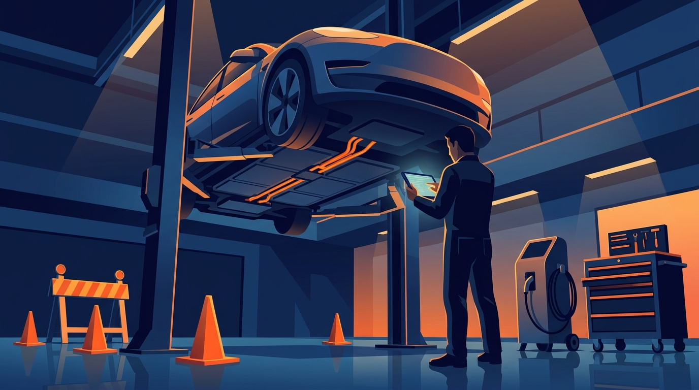
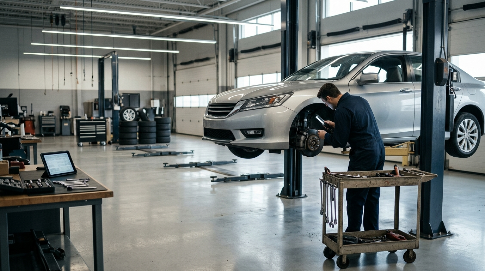
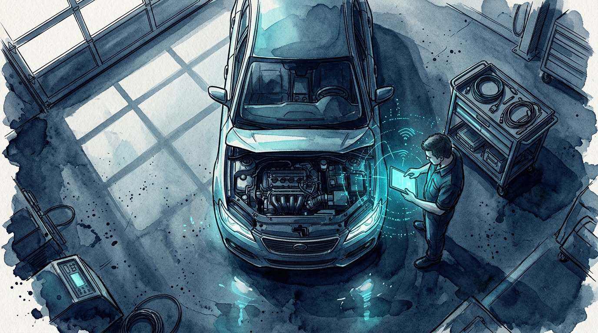
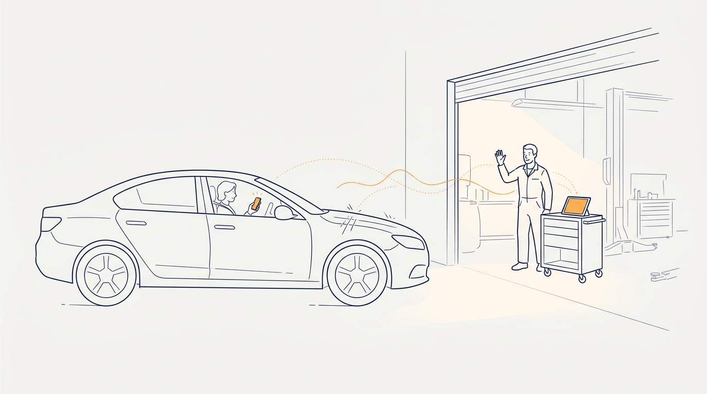

# Sample outputs

Generated by one call to the Batch Runner (`batch-20261117-130643-roclg3`): 7 topics, concurrency 3, wall time 158 s. Per-run latency p50 45 s, p95 64 s, max 64 s (7/7 within 5 minutes). Total model cost $0.55.

The last two rows use the **same topic with style `auto`** to show the diversity logic: the second run
sees the first in its history, so it must pick a different format, angle, hook, audience and visual direction.

| Image | Title and topic | Style | Words | Status | Time | Cost | Angle, hook, audience | Visual |
|---|---|---|---|---|---|---|---|---|
|  | [The Hybrid Car-Buying Playbook: What Goes Online, What Stays in the Showroom](01-the-hybrid-car-buying-playbook-what-goes-online-what-stays-i/article.md) Why the car-buying journey is moving online, and what still belongs in the showroom | article | 684 | success | 37 s | $0.0699 | playbook, scenario, skeptics who doubt the hype | cinematic still with shallow depth of field; earthy greens and sand |
|  | [How to Launch Digital Retailing Without Breaking Your Dealership](02-how-to-launch-digital-retailing-without-breaking-your-dealer/article.md) How to launch a digital retailing program at a car dealership | guide | 674 | success | 48 s | $0.0816 | contrarian, scenario, leaders planning for the next three years | cinematic still with shallow depth of field; earthy greens and sand |
|  | [Why Transparent, No-Haggle Pricing Is the Only Way Forward for Car Dealerships](03-why-transparent-no-haggle-pricing-is-the-only-way-forward-fo/article.md) Dealerships should publish transparent, no-haggle prices | opinion | 645 | success, 1 revision | 45 s | $0.0819 | contrarian, analogy, skeptics who doubt the hype | clean flat vector illustration; earthy greens and sand |
|  | [How Electric Vehicles Will Reshape Dealership Service Revenue](04-how-electric-vehicles-will-reshape-dealership-service-revenu/article.md) How electric vehicles will change dealership service revenue | trend_analysis | 546 | success | 44 s | $0.0743 | risks, mini_story, decision-makers weighing whether to invest | clean flat vector illustration; warm sunset oranges against deep blues |
|  | [5 Ways to Cut Used-Car Reconditioning Time and Boost ROI](05-5-ways-to-cut-used-car-reconditioning-time-and-boost-roi/article.md) Ways dealerships can cut used-car reconditioning time | listicle | 542 | success | 41 s | $0.085 | roi, analogy, practitioners who do the work every day | editorial photography; soft pastels |
|  | [From Guesswork to Telemetry: How Connected-Car Data Keeps Dealership Customers Returning](06-from-guesswork-to-telemetry-how-connected-car-data-keeps-dea/article.md) Using connected-car data to keep dealership customers coming back | article (auto) | 611 | success | 45 s | $0.0759 | history, contrast, decision-makers weighing whether to invest | watercolor and ink illustration; deep navy and electric cyan |
|  | [5 Ways Connected-Car Data Actually Wins Back Skeptical Drivers](07-5-ways-connected-car-data-actually-wins-back-skeptical-drive/article.md) Using connected-car data to keep dealership customers coming back | listicle (auto) | 575 | success | 63 s | $0.079 | customer_journey, question, skeptics who doubt the hype | minimal line art with a single accent color; warm sunset oranges against deep blues |

Each folder holds `article.md` (Markdown with front matter), the image and `metadata.json`
(plan, brief, quality checks per draft, every model call with latency and cost).
[batch-summary.json](batch-summary.json) is the Batch Runner's own report.
